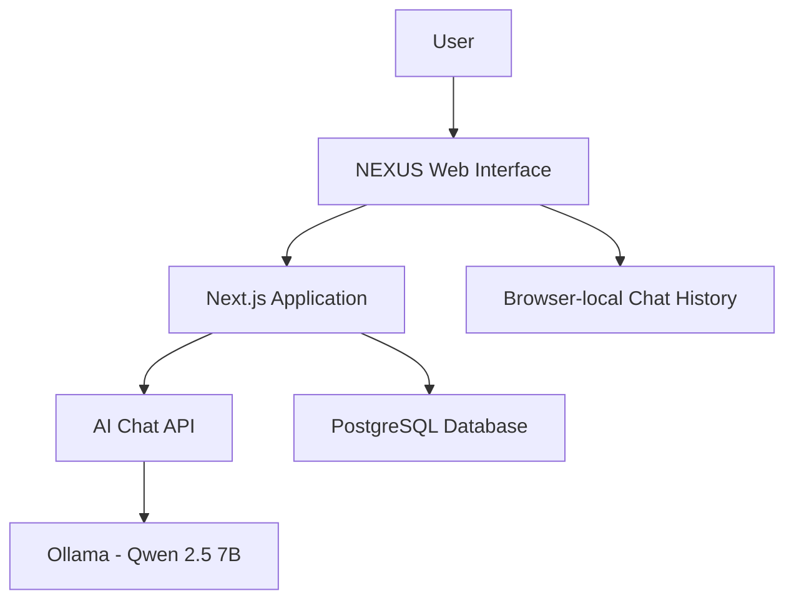

# NEXUS AI OS
### Enterprise Intelligence Operating System Powered by AI

**NEXUS AI OS** is an early-stage software project exploring how artificial intelligence can make computer interactions, business intelligence, and enterprise workflows more intelligent through natural-language interaction.

## Vision

To build an intelligent operating system that connects applications, assists users with tasks, and supports better business decisions using AI.

## Current Technology Stack

- **Frontend:** Next.js, TypeScript
- **AI Integration:** Ollama, Qwen 2.5 7B
- **Database:** PostgreSQL
- **Development:** AI-assisted software development

## Implemented Features

- Initial web application dashboard
- AI chat interface
- Integration with a locally running AI model
- Initial PostgreSQL database and table setup
- Multiple-conversation interface
- Browser-local chat history

## Currently in Development

- Server-side authentication and session verification
- Persistent conversation storage
- Improved database integration

## Future Roadmap

1. Enterprise document intelligence and retrieval-augmented generation (RAG)
2. Business analytics and decision intelligence
3. Intelligent workflow automation
4. Enterprise security and access management
5. Testing, performance optimisation, and deployment

*Roadmap items are planned features, not yet completed functionality.*

## Project Architecture



*Conceptual architecture of the current prototype; database persistence and authentication are still being developed.*

## Project Structure

```text
NEXUS-AI-OS/
├── .gitignore
├── README.md
└── web/
    ├── app/
    ├── lib/
    ├── public/
    ├── package.json
    └── ...
```

## Project Status

**Early-stage prototype — actively developing.**

NEXUS AI OS is an independent project developed through hands-on programming and AI-assisted development.

## Developer

**Founder & AI-Assisted Developer**

GitHub: [@pilladeepika167-oss](https://github.com/pilladeepika167-oss)

---

*Building towards a more intelligent way to work with technology.*